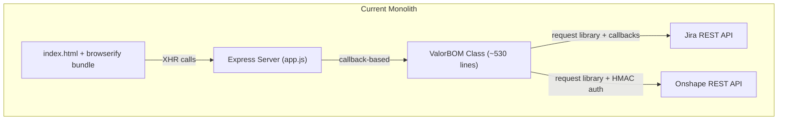
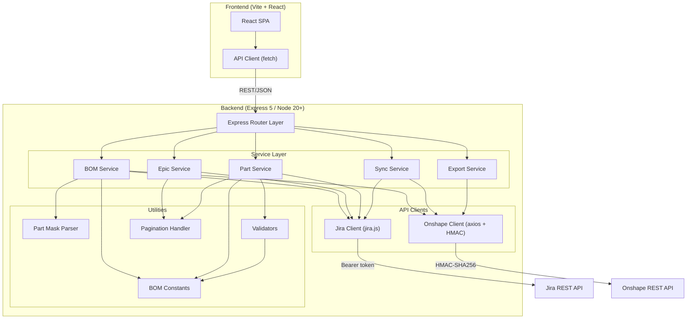
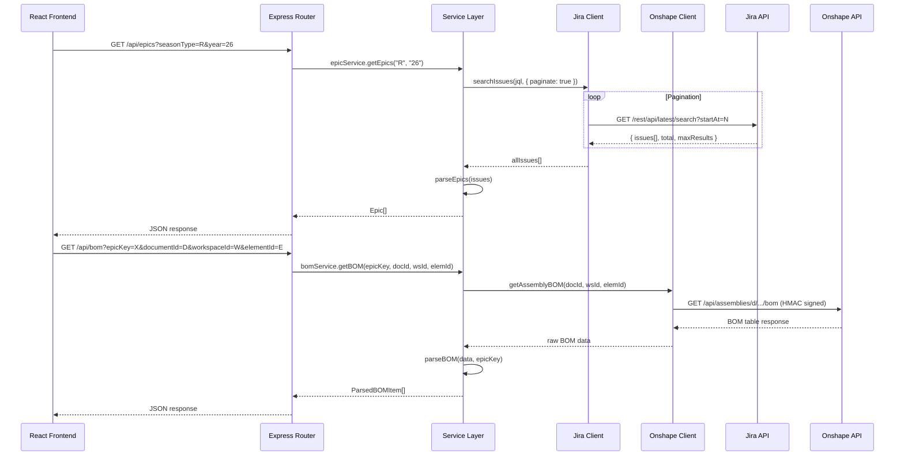
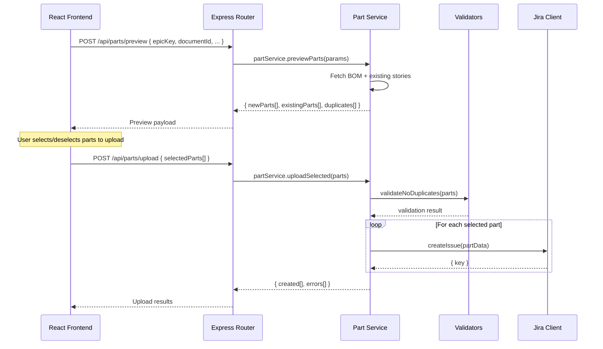

# Design Document: ValorBOM Modernization

## Overview

ValorBOM is a Bill of Materials (BOM) management tool that bridges Onshape CAD assemblies with Jira project tracking for a robotics team. The current implementation is a monolithic Node.js application (~530 lines in a single class) using deprecated libraries (`request`), callback-based patterns, browserified frontend, and tightly coupled business logic. The application is deployed via Docker on Portainer.

This modernization effort restructures the application into a modular, maintainable architecture using modern Node.js patterns (async/await, ES modules, proper separation of concerns), replaces deprecated dependencies with current alternatives, introduces a Vite + React frontend, and adds several new features: epic generation from URLs, selective part uploading, duplicate part number detection, automatic STEP file upload for 3D prints, and a fix for Jira pagination when retrieving epics.

The design preserves the existing deployment model (Docker/Portainer) and all current functionality while enabling incremental delivery of new features.

## Architecture

### Current Architecture



### Target Architecture



### Request Flow



### Selective Part Upload Flow (New Feature)




## Components and Interfaces

### Component 1: Jira Client (thin wrapper around `jira.js`)

**Purpose**: Thin wrapper around the [`jira.js`](https://mrrefactoring.github.io/jira.js/) npm package that provides a simplified, domain-specific interface for ValorBOM's Jira operations. `jira.js` is a well-maintained TypeScript library with full Jira Cloud REST API v2/v3 coverage, built-in pagination, type definitions, and authentication handling — eliminating the need for a from-scratch HTTP client.

**Interface**:
```javascript
interface JiraClient {
  searchIssues(jql: string, options?: { paginate: boolean, maxResults?: number }): Promise<JiraIssue[]>
  createIssue(fields: JiraIssueFields): Promise<{ key: string }>
  updateIssue(key: string, fields: Partial<JiraIssueFields>): Promise<void>
  getIssue(key: string): Promise<JiraIssue>
}
```

**Implementation Notes**:
- Wraps `jira.js` `Version2Client` (or `Version3Client`) configured with Bearer token auth from `JIRA_KEY` env var
- Delegates pagination to `jira.js` built-in pagination support rather than implementing custom pagination logic
- Maps `jira.js` response types to ValorBOM domain types (JiraIssue, JiraIssueFields)
- Centralizes error handling: catches `jira.js` errors and wraps them in typed ValorBOM errors

**Responsibilities**:
- Configuring and exposing a `jira.js` client instance with Bearer token authentication
- Providing a simplified search interface that leverages `jira.js` built-in pagination (fixes the current bug where only the first page is returned)
- Mapping between `jira.js` types and ValorBOM domain types
- Consistent error wrapping and response normalization
- Rate limiting awareness (leveraged from `jira.js` where available)

### Component 2: Onshape Client (custom, axios + HMAC-SHA256)

**Purpose**: Replaces all direct `request`-based Onshape HTTP calls with a custom API client built on axios that handles HMAC-SHA256 signing, nonce generation, and response parsing.

**Why custom**: There is no actively maintained Node.js SDK for Onshape. The official `onshape-clients` repository was archived in March 2023. The only community alternative (`onshape-axios`) receives ~1 download/week and is not viable for production use. A custom client with axios + HMAC-SHA256 signing is the only reliable approach.

**Interface**:
```javascript
interface OnshapeClient {
  getAssemblyBOM(documentId: string, workspaceId: string, elementId: string, options?: { multiLevel: boolean }): Promise<OnshapeBOMTable>
  getDocuments(query: string, options?: { teamId: string }): Promise<OnshapeDocument[]>
  getWorkspaces(documentId: string): Promise<OnshapeWorkspace[]>
  getElements(documentId: string, workspaceId: string, elementType?: string): Promise<OnshapeElement[]>
  exportSTL(documentId: string, workspaceId: string, elementId: string, partId: string): Promise<Buffer>
  exportSTEP(documentId: string, workspaceId: string, elementId: string, partId: string): Promise<Buffer>
}
```

**Responsibilities**:
- HMAC-SHA256 request signing (nonce, date, path-based signature)
- Onshape API key/secret management
- Binary export handling (STL, STEP)
- Response parsing and error handling

### Component 3: BOM Service

**Purpose**: Orchestrates BOM retrieval from Onshape and cross-references with Jira stories. Replaces the `getBOM` and `parseBOM` methods from the monolithic class.

**Interface**:
```javascript
interface BOMService {
  getBOM(epicKey: string, documentId: string, workspaceId: string, elementId: string): Promise<ParsedBOMItem[]>
  compareBOMWithJira(bomItems: ParsedBOMItem[], existingStories: JiraStory[]): BOMComparison
}
```

**Responsibilities**:
- Fetching assembly BOM from Onshape
- Parsing BOM table into structured part data
- Material-to-machinery auto-mapping via centralized `MATERIAL_MACHINERY_MAP` from constants (see Component 11)
- Validating material/machinery/powdercoat/thickness values against centralized enums
- Duplicate quantity aggregation for same part numbers
- Skipping nested sub-assembly items

### Component 4: Epic Service

**Purpose**: Manages Jira epic (Assembly) operations with proper pagination support.

**Interface**:
```javascript
interface EpicService {
  getEpics(seasonType: string, year: string): Promise<Epic[]>
  getEpic(fullPartNumber: string): Promise<Epic | null>
  createEpic(payload: EpicCreatePayload): Promise<{ key: string }>
  generateEpicFromURL(onshapeURL: string): Promise<{ key: string }>
}
```

**Responsibilities**:
- Paginated epic retrieval (fixes current pagination bug)
- Epic creation from Onshape document URLs (new feature)
- Parsing Onshape URLs to extract document/workspace/element IDs
- Epic name pattern matching (VR26A-XXXX format)

### Component 5: Part Service

**Purpose**: Manages Jira story (Part) CRUD operations with selective upload and duplicate detection.

**Interface**:
```javascript
interface PartService {
  getStoriesByEpic(epicKey: string): Promise<JiraStory[]>
  getStoriesByPartNumber(partNumber: string): Promise<JiraStory[]>
  previewParts(params: BOMParams): Promise<PartPreview>
  uploadSelected(parts: SelectedPart[]): Promise<UploadResult>
  createStory(payload: StoryPayload): Promise<{ key: string, fullPartNumber: string }>
  updateStory(key: string, payload: StoryPayload): Promise<void>
  detectDuplicates(parts: ParsedBOMItem[]): DuplicateReport
}
```

**Responsibilities**:
- Part CRUD against Jira
- Preview mode: returns new/existing/duplicate parts before upload (new feature)
- Selective upload: only creates tickets for user-selected parts (new feature)
- Duplicate part number detection across the project (new feature)
- Prevents ticket creation before explicit save (bug fix)
- Validates all field values against centralized enums from constants (see Component 11)

### Component 6: Sync Service

**Purpose**: Orchestrates the sync workflow between Onshape documents and Jira epics. Replaces the deeply nested callback chain in `syncEpics`.

**Interface**:
```javascript
interface SyncService {
  syncEpics(seasonType: string, year: string): Promise<SyncResult>
}
```

**Responsibilities**:
- Fetching Onshape documents matching season/year pattern
- Resolving workspaces and assemblies for each document
- Creating missing Jira epics for untracked assemblies
- Reporting sync results (created, skipped, errors)

### Component 7: Export Service

**Purpose**: Handles file exports from Onshape (STL, STEP) with automatic upload for 3D printed parts.

**Interface**:
```javascript
interface ExportService {
  exportSTL(documentId: string, workspaceId: string, elementId: string, partId: string): Promise<Buffer>
  exportSTEP(documentId: string, workspaceId: string, elementId: string, partId: string): Promise<Buffer>
  autoExportForPrint(part: ParsedBOMItem): Promise<ExportResult>
}
```

**Responsibilities**:
- STL/STEP file export from Onshape
- Automatic STEP export trigger for parts with 3D print machinery (new feature)
- File handling and temporary storage

### Component 8: Part Mask Parser (Utility)

**Purpose**: Extracts structured data from ValorBOM part number naming conventions. Replaces the static `applyTitleMask` and `applyPartMask` methods.

**Interface**:
```javascript
interface PartMaskParser {
  applyTitleMask(text: string): TitleMaskResult | null
  applyPartMask(text: string): PartMaskResult | null
  isValidPartNumber(text: string): boolean
}
```

**Responsibilities**:
- Parsing part number patterns: `V[RF]\d{2}[AP]-\d{4}[A-Z]? Name`
- Extracting season type, year, part type, part number, version, name
- Determining if a part is an epic (assembly) vs story (part)

### Component 9: Express Router Layer

**Purpose**: Thin routing layer that maps HTTP endpoints to service methods. Replaces the inline route handlers in `app.js`.

**Interface**:
```javascript
// Route modules
GET  /api/epics?seasonType&year        → epicService.getEpics()
GET  /api/epics/sync?seasonType&year   → syncService.syncEpics()
POST /api/epics/from-url               → epicService.generateEpicFromURL()
GET  /api/stories?key|partNumber       → partService.getStories()
POST /api/stories                      → partService.createStory()
PUT  /api/stories/:key                 → partService.updateStory()
GET  /api/bom                          → bomService.getBOM()
POST /api/parts/preview                → partService.previewParts()
POST /api/parts/upload                 → partService.uploadSelected()
POST /api/export/step                  → exportService.exportSTEP()
POST /api/export/stl                   → exportService.exportSTL()
```

**Responsibilities**:
- Request validation and parameter extraction
- Error response formatting
- Serving the React SPA (production build)

### Component 10: React Frontend

**Purpose**: Replaces the plain HTML + browserify bundle with a Vite + React SPA providing the same BOM management UI with enhanced UX for new features.

**Key Views**:
- Assembly Selection (season type, year, epic dropdown)
- Parts List Table (editable fields: quantity, material, machinery, powdercoat, thickness — dropdown options sourced from centralized constants)
- Part Upload Preview (new: select/deselect parts before upload)
- Duplicate Detection Warnings (new: highlights duplicate part numbers)

**Responsibilities**:
- All current UI functionality (assembly selection, BOM table, save/update)
- Part selection UI before upload (new feature)
- Duplicate part number warnings (new feature)
- Status badges and change tracking
- Print-friendly layout
- Dropdown options for material, machinery, powdercoat, and thickness fields sourced from shared constants

### Component 11: BOM Constants (Utility)

**Purpose**: Centralizes all configurable field options (materials, machinery, powdercoat, thickness) and material-to-machinery auto-mapping rules into a single module. These values were previously hardcoded inline in `parseBOM`. Extracting them makes the options easy to modify, ensures consistency across BOM Service, Part Service, validators, and the React frontend, and provides a single source of truth for all field enums.

**File**: `src/server/utils/bomConstants.js`

**Interface**:
```javascript
// Allowed values for each field (used in dropdowns, validation, and Jira field payloads)
const MATERIALS = ["None", "AL 6061", "PLA", "PETG-CF", "Nylon", "Wood", "Polycarb", "SRPP", "AL 7075"]

const MACHINERY = ["None", "CNC Mill", "CNC Router", "Manual Mill", "Manual Lathe", "3D Printer", "Manual"]

const POWDERCOAT = ["None", "Black", "Gold"]

const THICKNESS = ["None", "0.060", "0.090", "0.125", "0.1875", "0.250"]

// Material-to-machinery auto-mapping rules used during BOM parsing.
// Each entry maps a raw material substring (from Onshape) to a normalized
// material name and default machinery assignment.
// Key: lowercase substring to match against raw Onshape material displayName
// Value: { material: normalized material name, machinery: default machinery }
const MATERIAL_MACHINERY_MAP = {
  "6061":          { material: "AL 6061",  machinery: "CNC Router" },
  "pla":           { material: "PLA",      machinery: "3D Printer" },
  "petg":          { material: "PETG-CF",  machinery: "3D Printer" },
  "nylon":         { material: "Nylon",    machinery: "3D Printer" },
  "birch":         { material: "Wood",     machinery: "CNC Router" },
  "wood":          { material: "Wood",     machinery: "CNC Router" },
  "polycarbonate": { material: "Polycarb", machinery: "CNC Router" },
  "polypropylene": { material: "SRPP",     machinery: "CNC Router" },
  "7075":          { material: "AL 7075",  machinery: "Manual Lathe" },
}
```

**Responsibilities**:
- Single source of truth for all configurable BOM field options
- Consumed by BOM Service for material-to-machinery auto-mapping during `parseBOM`
- Consumed by Part Service and validators for field value validation
- Consumed by React frontend for populating dropdown options
- Easy to extend: adding a new material or machinery option requires changing only this file


## Data Models

### Model 1: Epic

```javascript
interface Epic {
  key: string                    // Jira issue key, e.g. "VAL-123"
  summary: string                // Full part string, e.g. "VR26A-0001 Drivetrain"
  fullPartNumber: string         // e.g. "VR26A-0001"
  name: string                   // e.g. "Drivetrain"
  seasonType: "R" | "F"         // Robot or Facility
  year: string                   // e.g. "26"
  partNumber: string             // e.g. "0001"
  isEpic: true
  documentId: string | null      // Onshape document ID (customfield_10300)
  workspaceId: string | null     // Onshape workspace ID (customfield_10301)
  elementId: string | null       // Onshape element ID (customfield_10302)
}
```

**Validation Rules**:
- `fullPartNumber` must match pattern `V[RF]\d{2}A-\d{4}`
- `seasonType` must be "R" or "F"
- `year` must be a 2-digit string
- `key` must be a valid Jira issue key

### Model 2: JiraStory (Part)

```javascript
interface JiraStory {
  key: string                    // Jira issue key
  summary: string                // Full part string with version
  fullPartNumber: string         // e.g. "VR26P-0001A"
  name: string
  version: string                // e.g. "A"
  seasonType: "R" | "F"
  year: string
  partNumber: string
  isEpic: false
  epic: string                   // Parent epic key
  material: string               // e.g. "AL 6061", "PLA", "None"
  machinery: string              // e.g. "CNC Router", "3D Printer", "None"
  powdercoat: string             // e.g. "Black", "Gold", "None"
  quantity: number
  thickness: string              // e.g. "0.125", "None"
  project: string                // Jira project key
}
```

**Validation Rules**:
- `fullPartNumber` must match pattern `V[RF]\d{2}P-\d{4}[A-Z]`
- `quantity` must be a positive integer
- `material` must be a value in `MATERIALS` constant (see Component 11)
- `machinery` must be a value in `MACHINERY` constant (see Component 11)
- `powdercoat` must be a value in `POWDERCOAT` constant (see Component 11)
- `thickness` must be a value in `THICKNESS` constant (see Component 11)

### Model 3: ParsedBOMItem

```javascript
interface ParsedBOMItem {
  fullPartNumber: string
  name: string
  quantity: number
  material: string
  machinery: string
  thickness: string
  powdercoat: string
  epic: string                   // Parent epic key
  seasonType: string
  year: string
  partNumber: string
  version: string
}
```

**Validation Rules**:
- `quantity` must be positive (aggregated across duplicate entries)
- Nested sub-assembly items (containing "." in item path) are excluded

### Model 4: PartPreview (New)

```javascript
interface PartPreview {
  newParts: ParsedBOMItem[]       // Parts not yet in Jira
  existingParts: {                // Parts already tracked
    bomItem: ParsedBOMItem
    story: JiraStory
    changes: ChangeLog
  }[]
  duplicates: {                   // Duplicate part numbers detected
    partNumber: string
    occurrences: ParsedBOMItem[]
  }[]
}
```

### Model 5: ChangeLog

```javascript
interface ChangeLog {
  count: number
  quantity?: number
  machinery?: string
  material?: string
  powdercoat?: string
  thickness?: string
}
```

### Model 6: SyncResult

```javascript
interface SyncResult {
  created: { fullPartNumber: string, key: string }[]
  skipped: { fullPartNumber: string, reason: string }[]
  errors: { fullPartNumber: string, error: string }[]
}
```

### Model 7: Jira Custom Field Mapping

The application uses Jira custom fields extensively. This mapping must be maintained:

| Field | Custom Field ID | Type |
|-------|----------------|------|
| Epic Name | customfield_10104 | string |
| Epic Link | customfield_10110 | string |
| Machinery | customfield_10201 | array of { value } |
| Material | customfield_10202 | { value } |
| Powdercoat | customfield_10204 | { value } |
| Quantity | customfield_10206 | number |
| Thickness | customfield_10207 | { value } |
| Document ID | customfield_10300 | string |
| Workspace ID | customfield_10301 | string |
| Element ID | customfield_10302 | string |

## Error Handling

### Error Scenario 1: Jira API Failures

**Condition**: Jira REST API returns non-2xx status or network error
**Response**: Wrap in typed error with status code, message, and the failing Jira endpoint. Return structured error to frontend.
**Recovery**: Retry transient errors (5xx, network timeouts) with exponential backoff. Surface 4xx errors to user with actionable message.

### Error Scenario 2: Onshape Authentication Failure

**Condition**: HMAC signature rejected (401/403) or API keys invalid
**Response**: Log signature details (without secrets) for debugging. Return clear "Onshape authentication failed" error.
**Recovery**: Verify API key/secret env vars are set. Check clock drift (HMAC is time-sensitive).

### Error Scenario 3: BOM Parse Failure

**Condition**: Onshape BOM table missing required columns (quantity, partNumber, material, name)
**Response**: Return descriptive error listing which required columns are missing (preserves current behavior).
**Recovery**: User must fix the Onshape assembly BOM configuration.

### Error Scenario 4: Duplicate Part Numbers

**Condition**: Multiple parts with the same part number detected during upload preview
**Response**: Return duplicates in the preview response with all occurrences listed. Block upload of duplicates unless user explicitly confirms.
**Recovery**: User resolves duplicates in Onshape before re-uploading.

### Error Scenario 5: Partial Upload Failure

**Condition**: Some parts fail to create in Jira during batch upload
**Response**: Return partial result with successfully created parts and individual error details for failures.
**Recovery**: User can retry failed parts without re-uploading successful ones.

## Testing Strategy

### Unit Testing Approach

Maintain Jest as the test runner. Each service module gets its own test file. Mock the Jira and Onshape clients at the service boundary.

Key test areas:
- Part mask parsing (regex correctness, edge cases)
- BOM parsing (material mapping via `MATERIAL_MACHINERY_MAP`, quantity aggregation, nested item filtering)
- BOM constants integrity (all `MATERIAL_MACHINERY_MAP` values exist in `MATERIALS` and `MACHINERY` arrays)
- Duplicate detection logic
- Pagination assembly (multiple pages into single result)
- Change log generation

### Integration Testing Approach

Test the Express routes with supertest, mocking service layer responses. Verify:
- Correct HTTP status codes and response shapes
- Query parameter validation
- Error response formatting
- Route-to-service wiring

### Property-Based Testing Approach

**Property Test Library**: fast-check

Properties to verify:
- Part mask parser: any valid part number string round-trips through parse → format
- BOM parser: output quantity is always ≥ input quantity (aggregation never loses items)
- Pagination: total items returned equals sum across all pages
- Duplicate detector: reported duplicates always have count > 1

## Performance Considerations

- Pagination fix will increase Jira API calls for large projects. Implement concurrent page fetching where possible.
- BOM sync involves multiple sequential API calls (documents → workspaces → assemblies → epics). Use `Promise.all` for independent calls within each level.
- React frontend eliminates the browserify build step and enables code splitting for faster initial load.
- STEP file exports can be large. Stream responses rather than buffering entire files in memory.

## Security Considerations

- **axios supply chain compromise (March 31, 2026)**: There is an active supply chain compromise affecting the `axios` npm package. Pin to a known-safe version (1.7.9 or earlier) in `package.json` using an exact version (`"axios": "1.7.9"`, not `"^1.7.9"`). Verify the package integrity hash in `package-lock.json` after install. As an alternative, consider replacing axios with `undici` (Node.js built-in HTTP client, available since Node 18) or `got` for the Onshape client if the axios situation is not resolved by implementation time. This only affects the Onshape client — Jira calls use `jira.js` which manages its own HTTP transport.
- Onshape API secret key must never be logged or exposed in error messages. The HMAC signing logic must sanitize all debug output.
- Jira Bearer token stored in env var only, never hardcoded or sent to frontend.
- Express routes should validate all query/body parameters to prevent JQL injection in Jira search queries.
- Docker image should continue running as non-root user (current `USER node` directive).
- Environment variables (`.env`) must remain in `.gitignore`.

## Dependencies

### Production Dependencies (Replacing)

| Current | Replacement | Reason |
|---------|-------------|--------|
| `request` (deprecated) — Jira calls | `jira.js` | Well-maintained TypeScript SDK with full Jira Cloud REST API v2/v3 coverage, built-in pagination, type definitions, and authentication handling. Eliminates need for custom HTTP client for Jira. See https://mrrefactoring.github.io/jira.js/ |
| `request` (deprecated) — Onshape calls | `axios` (pinned ≤1.7.9) | Modern HTTP client with Promise support, interceptors, HMAC signing compatibility. Required for custom Onshape client since no viable Onshape SDK exists. **See Security Note below.** |
| `body-parser` | `express.json()` | Built into Express 4.16+, no separate package needed |
| `browserify` | `vite` | Modern build tool with HMR, React support, code splitting |

### Production Dependencies (Keeping)

| Package | Reason |
|---------|--------|
| `express` | Upgrade to latest 4.x or 5.x |
| `fast-csv` | Still maintained, works well for CSV parsing |
| `multer` | Still maintained, needed for file uploads |
| `dotenv` | Still maintained, standard env var loading |

### New Production Dependencies

| Package | Purpose |
|---------|---------|
| `jira.js` | Jira Cloud REST API client — replaces all custom Jira HTTP logic. Provides typed methods for search, create, update with built-in auth and pagination. |
| `axios` (pinned ≤1.7.9) | HTTP client for Onshape API calls only (custom HMAC-signed requests). **Not used for Jira.** See Security Note. |
| `react` + `react-dom` | Frontend framework |
| `@tanstack/react-query` | Server state management for API calls |
| `tailwindcss` | Already used via CDN, move to proper build |

### New Dev Dependencies

| Package | Purpose |
|---------|---------|
| `vite` | Frontend build tool |
| `@vitejs/plugin-react` | React support for Vite |
| `fast-check` | Property-based testing |
| `supertest` | HTTP integration testing |

### Removed Dependencies

| Package | Reason |
|---------|--------|
| `request` | Deprecated since 2020 |
| `body-parser` | Replaced by built-in Express middleware |
| `browserify` | Replaced by Vite |
| `cross-env` | Not needed with modern Node.js |

### Infrastructure

- Node.js: Upgrade from 18.x to 20.x LTS (or 22.x LTS) in Dockerfile
- Docker: Update base image to `node:20-slim` (or `node:22-slim`)
- Remove `sys/` directory (bom.service, runner.sh) — no longer needed with Docker/Portainer deployment

## Project Structure

```
valorbom/
├── src/
│   ├── server/
│   │   ├── index.js              # Express app entry point
│   │   ├── routes/
│   │   │   ├── epicRoutes.js
│   │   │   ├── partRoutes.js
│   │   │   ├── bomRoutes.js
│   │   │   └── exportRoutes.js
│   │   ├── services/
│   │   │   ├── bomService.js
│   │   │   ├── epicService.js
│   │   │   ├── partService.js
│   │   │   ├── syncService.js
│   │   │   └── exportService.js
│   │   ├── clients/
│   │   │   ├── jiraClient.js
│   │   │   └── onshapeClient.js
│   │   └── utils/
│   │       ├── partMask.js
│   │       ├── bomConstants.js    # Centralized enums: materials, machinery, powdercoat, thickness, material-machinery map
│   │       ├── validators.js
│   │       └── pagination.js
│   └── client/                   # Vite + React frontend
│       ├── index.html
│       ├── src/
│       │   ├── App.jsx
│       │   ├── main.jsx
│       │   ├── components/
│       │   ├── hooks/
│       │   └── api/
│       ├── vite.config.js
│       └── tailwind.config.js
├── __tests__/
│   ├── services/
│   ├── clients/
│   ├── utils/
│   └── routes/
├── Dockerfile
├── package.json
└── .env
```
